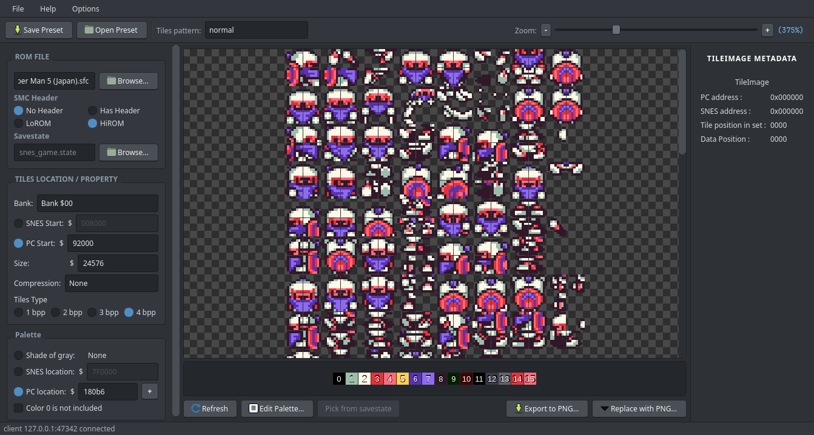

# SNESTilesRipper — User Guide

SNESTilesRipper views, extracts and re-injects SNES graphics (tiles) and
palettes directly from a ROM file. You point it at a byte range in the ROM,
tell it how the bytes must be decoded (bits-per-pixel, compression, tile
arrangement, palette), and it renders the result. You can then export the
tiles as PNG, or inject a modified PNG back into the ROM.

> **Addresses 101.** *SNES addresses* (`$008000`, `$814C3A`, …) are the
> addresses the SNES CPU sees. *PC addresses* (`$002000`, `$180B6`, …) are
> raw file offsets you could also use in a hex editor. PC addresses always
> assume the file has **no** 512-byte SMC header. The tool converts between
> both automatically once you tell it the mapping (**LoROM**/**HiROM**) and
> whether the file has a header.

---

## 1. Menu bar

| Menu | Item | What it does |
|------|------|--------------|
| **File** | Open ROM… (`Ctrl+O`) | Load a `.smc` / `.sfc` / `.gfx` / `.bin` ROM. Auto-detects header and LoROM/HiROM. |
| | Open Preset… | Load a `.stk` preset (tile location, size, bpp, compression, palette, pattern). |
| | Save Preset… (`Ctrl+S`) | Save the current settings as a `.stk` preset (asks for a preset name). |
| | Export to PNG… | Save the currently extracted tiles as a PNG image. |
| | Replace with PNG… | Inject a PNG back into the ROM (opens the inject dialog). Disabled for compressions that cannot be re-compressed. |
| | Quit (`Ctrl+Q`) | Close the program. |
| **Help** | MCP documentation… | Opens the built-in MCP/AI-control documentation window (with a *Copy* button). |
| | About… | Opens the project repository on GitHub in your browser. |
| **Options** | Language | Switch UI language (`en`, `pt_BR`, …). New `translations/*.txt` files appear here without restarting. |
| | MCP AI control server ☑ | Starts/stops a local MCP server (`http://127.0.0.1:8765/mcp`) so an AI agent can drive the tool. The checkbox always shows its box: empty = off, filled = on. |

---

## 2. Top toolbar

| Control | What it does |
|---------|--------------|
| **Save Preset** | Same as *File → Save Preset…*. |
| **Open Preset** | Same as *File → Open Preset…*. |
| **Tiles pattern:** dropdown | How 8×8 tiles are arranged on screen: `normal` (linear) or `32x32 A/B` groups. Purely visual, and reversible. |
| **Zoom: − / slider / + / (%)** | Tile pixel size (slider 1–100 px) with live percentage (`value × 100 ÷ 8`). `Ctrl + mouse wheel` over the tile view also zooms; `Ctrl++` / `Ctrl+-` work everywhere. Left-click + drag pans the view. |

---

## 3. Left panel

### ROM FILE
- **Path field + Browse…** — the loaded ROM file (read-only display).
- **SMC Header: No Header / Has Header** — whether the file contains the 512-byte copier header. Auto-detected on load; PC addresses ignore it.
- **LoROM / HiROM** — SNES memory mapping. Auto-detected from the ROM header; used for SNES ↔ PC conversion.
- **Savestate + Browse…** — load a Snes9x savestate (`.state`) to reuse its live palettes (enables *Pick from savestate* below).

### TILES LOCATION / PROPERTY
- **Bank:** dropdown — jumping helper: picking `Bank $XX` fills *PC Start* with `XX×$10000` and *Size* with `$10000`.
- **SNES Start: $ / PC Start: $** — radio + hex field selecting which address space locates the tile data. Only the checked one is used.
- **Size: $** — number of bytes to decode (decimal or hex digits; `4bpp` tiles use 32 bytes each).
- **Compression:** — `None` or a loaded plugin (`Quintet1`, `nintendo1/2`, `Konami1`, `SBM5RLE`, … from `bin/plugins/`). With a lossy/one-way compression the *Replace with PNG* button disables itself.
- **Tiles Type: 1/2/3/4 bpp** — bits per pixel of the tile format (4bpp = 16 colors, the most common for sprites).

### Palette
- **Shade of gray:** — fallback grayscale palette when the real palette location is unknown.
- **SNES location: $ / PC location: $** — radio + hex field with the 32-byte (16-color) SNES palette in the ROM.
- **+** — increments the PC palette address by 1 (handy for walking through palette tables).
- **Color 0 is not included** — skip color 0 when reading the palette from ROM (some games store 15 useful colors).

---

## 4. Center: tile view

- The decoded tiles on a **checkerboard background** — checker squares shine through wherever a pixel uses palette **color 0** (transparency), so you can see at a glance which pixels are transparent.
- **Palette strip** under the view shows the 16 currently active colors (indices 0–15).
- Hovering a tile shows a magnified preview plus its addresses in the right panel.

### Bottom bar
| Button | What it does |
|--------|--------------|
| **Refresh** (`F5`) | Re-read ROM with the current settings and redraw tiles + palette. The main “apply” button. |
| **Edit Palette…** | Opens the Palette Editor (see §6). |
| **Pick from savestate** | Opens the savestate palette picker (needs a loaded savestate). Applies a CGRAM palette live. |
| **Export to PNG…** | Same as *File → Export to PNG…*. |
| **Replace with PNG…** | Same as *File → Replace with PNG…*. |

---

## 5. Right panel — TILEIMAGE METADATA

Live info about the tile under the cursor:

- **PC address / SNES address** — where this exact tile lives in the ROM.
- **Tile position in set** — tile index in the extracted set.
- **Data Position** — byte offset of the tile inside the extracted data (`index × bpp × 8`).

---

## 6. Dialogs

### Edit Palette…
- Palette size radios (**2/4/8/16**), clickable color grid, **Index** display.
- **R / G / B** fields (0–255) and **SNES Value** field (the native 15-bit `$0BBBGGRRRRR` word) — editing either side updates the other; edits apply live to the main view.
- **Search in ROM** — finds the current palette bytes inside the loaded ROM and reports the PC address.
- **Save / Save & Quit** — keep or keep-and-close.

### Pick from savestate…
- Grid of the 8 SNES CGRAM palettes from the savestate; click one to preview it in the main view (*Update Sprite scene when selecting palette*), **Save & quit** to keep it or **Cancel & quit** to discard.

### Replace with PNG… (inject)
- Choose the PNG, optionally **work on a copy of the ROM** (`*_copy.sfc`, recommended — never touches your original) and choose **palette from image** vs **original palette** (also injects the PNG's palette into the ROM when the preset has a palette address).
- Warns if the injected data is larger than the preset length (would corrupt following data).

### Save preset
- Asks for a preset name, then a `.stk` file path. `.stk` files are plain INI (`[tiles]`, `[palette]`, `[rom]`) — see `Presets/` for examples.

---

## 7. Keyboard & mouse reference

| Input | Action |
|-------|--------|
| `Ctrl+O` / `Ctrl+S` / `Ctrl+Q` | Open ROM / Save preset / Quit |
| `F5` | Refresh |
| `F1` | Increment PC palette address (+) |
| `Ctrl++` / `Ctrl+-` | Zoom in / out |
| `Ctrl + wheel` on tile view | Zoom |
| Left-drag on tile view | Pan |

---

## 8. Typical workflow (example: Bomberman sprites)

1. *File → Open ROM…* — e.g. `Super Bomber Man 5 (Japan).sfc` (auto: HiROM, no header).
2. Left panel: *PC Start* `$92000`, *Size* `24576`, *4 bpp*, *Compression None*, palette *PC location* `$180B6`.
3. Press **Refresh** — the White Bomberman sheet appears.
4. Tweak: walk palettes with **+**, try *Tiles pattern* `32x32 A`, zoom in.
5. *Export to PNG…* to save the sheet; or load a ready-made preset from `Presets/` (e.g. *Super Bomberman 5 - White Bomberman.stk*) and just press Refresh.

Ship-ready presets for this game live in `Presets/`: White (`$180B6`), Red (`$180E2`) and Yellow (`$181BE`) Bomberman, plus Plunder Bomber (`$186B6`) — all tiles at PC `$92000`.

---

## 9. See also

- [MCP_SERVER.md](MCP_SERVER.md) — drive every feature above from an AI agent (tool list, protocol, examples).
- `translations/README.txt` — add your own UI language.
- Command-line twin: `SNESTilesRipperCLI` (`src/tinymain.cpp`) for scripted export/inject jobs.
